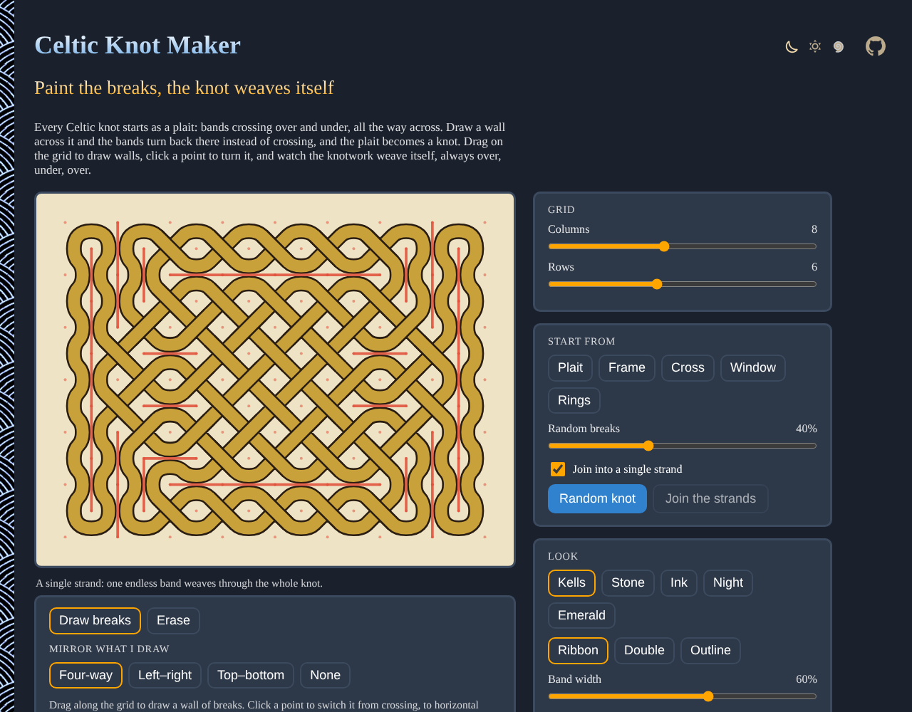

# Celtic-Knot-Maker

Paint breaks on a grid and the Celtic knotwork weaves itself, over and under. Draw your own knot or start from a frame, a cross, rings or a random knot made of a single strand, then save it as an SVG or a PNG. No sign-up and no libraries.

- [Make a Celtic knot](https://evoluteur.github.io/celtic-knot-maker/)

## What it does

- **Draw breaks**: drag along the grid to draw a wall of breaks, click a point to switch it from crossing, to horizontal break, to vertical break. **Erase** removes them.
- **Mirror what I draw**: four-way, left–right, top–bottom or none.
- **Grid**: 2 to 16 columns and 2 to 12 rows. Resizing keeps the breaks that still fit.
- **Start from**: a plain plait, a frame, a cross, a window, nested rings, or a **random knot** (optionally joined into a single strand). **Join the strands** turns any design into one endless strand.
- **Look**: five color schemes (Kells, stone, ink, night, emerald), ribbon, double or outline bands, the band width, a color for each strand, and over and under swapped.
- **Save**: **Download PNG** (2000 pixels wide) or **Download SVG**, without the grid. The address of the page keeps the knot, to share it.

## How it works

This is George Bain's method, from *Celtic Art: The Methods of Construction* (1951). A knot starts as a plait: bands running diagonally across a grid and crossing at the middle of every cell side. A *break* at a crossing cuts the two bands and joins their ends the other way, so they turn back instead of crossing. Line up breaks into walls and the plait becomes a knot.

The over and under never needs fixing: the crossings sit on the cell sides like the squares of a checkerboard, a band going down and right is over on the vertical sides and under on the horizontal ones, and when it turns back at a break it skips a crossing but changes direction too. However you draw the breaks, the knot is always a true weave.

These are the same *mirror curves* as the sikku kolams of South India (see [Kolam-Maker](https://github.com/evoluteur/kolam-maker)), drawn as woven bands instead of a line of rice flour. To join strands, the page uses the same trick: a break where two different strands cross always makes them one.

## How it is built

Plain HTML, CSS and JavaScript, with no dependencies and no build step. Just open `index.html`. It is also a small installable web app that works offline.

- The knot is one SVG: each strand is drawn as a dark edge and a band, then the band going over is drawn again at every crossing. All the code is in [js/celtic.js](https://github.com/evoluteur/celtic-knot-maker/blob/main/js/celtic.js).
- The three color themes (dark, light and blue) are shared with my other projects, copied from [omg-themes](https://github.com/evoluteur/omg-themes) (`npm run sync:themes` refreshes them).

Celtic-Knot-Maker is open source at [GitHub](https://github.com/evoluteur/celtic-knot-maker) with MIT license.

Had fun browsing the app? [Buy me a coffee by becoming a sponsor](https://github.com/sponsors/evoluteur).

You may also be interested in [Mandala-Maker](https://github.com/evoluteur/mandala-maker) ([demo](https://evoluteur.github.io/mandala-maker/)), [Kolam-Maker](https://github.com/evoluteur/kolam-maker) ([demo](https://evoluteur.github.io/kolam-maker/)), [Rose-Window-Maker](https://github.com/evoluteur/rose-window-maker) ([demo](https://evoluteur.github.io/rose-window-maker/)) and [Labyrinth-Maker](https://github.com/evoluteur/labyrinth-maker) ([demo](https://evoluteur.github.io/labyrinth-maker/)). For more mystic arts as small web apps, see [Esoterica](https://evoluteur.github.io/esoterica.html).

Copyright (c) 2026 [Olivier Giulieri](https://evoluteur.github.io/).
